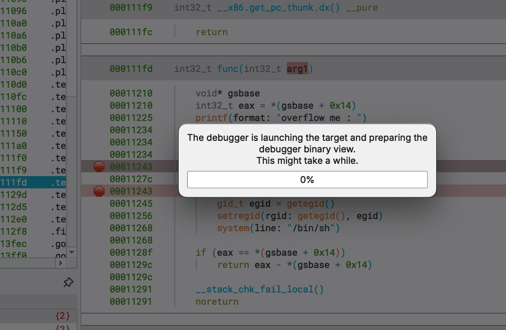
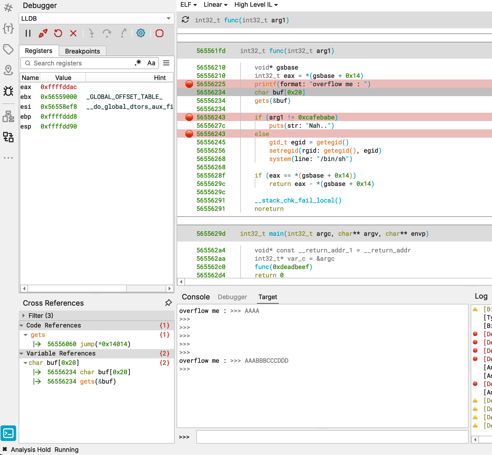
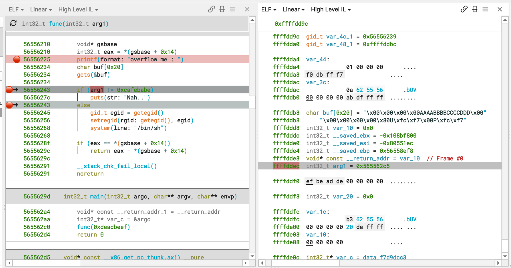

#+TITLE: binary ninja
#+DATE: 2026-11-02
#+AUTHOR: Michael Plankl
#+IMAGE_SAVE_DIR: content/cheatsheets/binary-ninja/images/

Notes from a debugging session with Binary Ninja Free 6.0.10905 on an M4 Pro
MacBook and a 32-bit x86 Linux executable (=bof=). The target ran on an x86-64
Debian VPS. These are the setup steps, problems, and solutions from that session.

* Remote Debugging: Which Method?

Use *Linux Remote Debugging (Using Debug Server)* with the *LLDB* adapter.
Choose the platform based on the target: =remote-linux=, even though Binary
Ninja runs on macOS. The VPS executes the program; the Mac runs the debugger UI.

From the directory containing the bundled Linux =lldb-server=, run on the VPS:

#+begin_src bash
mkdir -p ~/bn-debug
realpath ~/bn-debug

./lldb-server platform --server \
  --listen 0.0.0.0:31337 \
  --gdbserver-port 31338
#+end_src

Leave the server running. Keep the debugger reachable through a private/VPN
network or restrict access to the Mac. This setup uses two ports: =31337= for
the platform connection and =31338= for the process connection.

** Which IP Address Field?

Open the binary locally, then choose =Debugger > Connect to Debug Server=.
In Debug Adapter Settings, use the *debugServer* section:

| Setting                       | Value                          |
|-------------------------------+--------------------------------|
| Debug adapter                 | =LLDB=                         |
| =debugServer > IP Address=     | reachable IP address of the VPS |
| =debugServer > Port=           | =31337=                        |
| =debugServer > Platform=       | =remote-linux=                 |

The =connect= section is for the separate /Connect to Remote Process/ method.
Changing its IP field does not configure the debug-server connection.

** The Binary Exists Only on the Mac

LLDB can upload it automatically:

| Setting                              | Value                           |
|--------------------------------------+---------------------------------|
| =debugServer > Disable Auto Install=  | unchecked                       |
| =launch > Executable Path=            | local path on the Mac           |
| =launch > Working Directory=          | absolute directory on the VPS   |

Keep =Input File= pointing to the local binary too. Set auto-install *before
connecting*; disconnect and reconnect if already connected. The working
directory must exist on the VPS. Use the path printed by =realpath ~/bn-debug=.

After connecting, set a breakpoint and click Launch. LLDB uploads the executable
and runs it remotely.

* Troubleshooting: Launch

** Warning Says "on Your Machine"

The launch confirmation showed a local =/Users/.../bof= path and said the binary
would run "on your machine". The LLDB adapter can display this wording even for
a remote launch. The message alone does not identify the execution host.

Make sure /Connect to Debug Server/ succeeded in the current session before
confirming. A local executable path is expected when using automatic upload.

** Launch Stays at 0%

#+CAPTION: Launch was stuck at this dialog. The percentage alone did not explain the cause.
#+ATTR_HTML: :alt Binary Ninja launch progress dialog stuck at zero percent

A stack sample caught Binary Ninja's UI thread blocked on a lock while the VPS
connection still existed. Testing separately with the bundled LLDB revealed a
concrete launch failure:

#+begin_example
Cannot launch '/home/user/bn-debug/bof':
execve failed: No such file or directory
#+end_example

The executable had uploaded successfully. The missing file was its *32-bit
Linux loader*, =/lib/ld-linux.so.2=.

** Install the Missing 32-bit Runtime

On the Debian x86-64 VPS:

#+begin_src bash
sudo apt update
sudo apt install libc6-i386
ldd ~/bn-debug/bof
#+end_src

After installation, the executable ran and =ldd= resolved =libc.so.6= through
=/lib32/libc.so.6= and the loader through =/lib/ld-linux.so.2=.

Restart Binary Ninja if it is still unresponsive, reconnect to the debug server,
and launch again. The missing runtime was a confirmed launch blocker; it did
not prove the cause of the UI lock. Later, a failed connection also required
starting =lldb-server= again.

* Troubleshooting: gets Waits for Input

The program printed =overflow me := and waited inside =gets=. Entering
=AAAABBBBCCCCDDD= in the Target console did not reach the next breakpoint.
Sending a newline through that console did not resolve it either.

#+CAPTION: The target was running, but input in the Target console did not release gets in this session.
#+ATTR_HTML: :alt Binary Ninja Target console with input while execution waits inside gets

The working workaround was *stdin redirection from a file on the VPS*.

Run this in the *VPS SSH terminal*:

#+begin_src bash
printf '%s\n' 'AAAABBBBCCCCDDD' > ~/bn-debug/input.txt
realpath ~/bn-debug/input.txt
#+end_src

Set =Debug Adapter Settings > launch > Redirect stdin= to the absolute *VPS*
path, e.g. =/home/user/bn-debug/input.txt=. Restart the target and continue
through the breakpoints. Execution then reached the =if= after =gets=.

- =gets= finishes on a newline or EOF.
- Command-line arguments do not provide stdin.
- The file supplies the actual input bytes; typing a literal =\n= does not send
  a newline byte.
- Edit the file and restart the target to test another input.

This was a working workaround for this session, not a diagnosis of every
remote Target-console input problem.

* View the Stack

While paused, choose =Debugger > Create Stack View=. It opens a second pane at
the stack pointer. Use Linear view for variable labels or Hex view for bytes
and ASCII.

The *Debugger* console accepts LLDB commands; the *Target* console is for
program input.

| Debugger command | What it shows                                 |
|------------------+-----------------------------------------------|
| =x/32wx $esp=    | 32 four-byte stack entries, in hexadecimal    |
| =bt=            | call stack, e.g. =func= called by =main=       |

* Stack Variables: Automatic Annotations

** Automatic Stack Variable Annotations

1. Enable =Stack Variable Annotations= in Settings
   (=debugger.stackVariableAnnotations=).
2. If the debugger was already open, save the database and fully restart Binary
   Ninja. In 6.0 the setting is read when the debugger controller is created.
3. Reopen the binary, reconnect, launch, and stop inside =func=.
4. Use =Create Stack View= with the stack pane in Linear view.

Annotations are generated automatically when the target stops; there is no
separate annotate command. At least two stack frames must be available.

#+CAPTION: Automatic labels in Linear view beside func. In this screenshot the buf and arg1 labels are four bytes before their assembly-verified locations.
#+ATTR_HTML: :alt Binary Ninja automatically annotated stack with buf, arg1, saved registers, and a frame marker

** Read buf & arg1 in This Screenshot

The left pane is paused at the =if= after =gets=. The right pane now has names
and types such as =char buf[0x20]=, =arg1=, saved registers, and =Frame #0=.

*The automatic labels need verification.* In this screenshot they are shifted
four bytes toward lower addresses compared with the layout checked in this
session:

| Variable | Automatic label | Verified address |
|----------+-----------------+------------------|
| =buf=    | =0xffffddb8=   | =0xffffddbc=    |
| =arg1=   | =0xffffddec=   | =0xffffddf0=    |

- The rendered =buf= starts with four =\x00= bytes before =AAAABBBBCCCCDDD=.
  The actual input begins four bytes after that label, at =0xffffddbc=.
- The label =arg1= shows =0x565562c5= at =0xffffddec=. That is the return
  address after the call to =func=, not the =0xdeadbeef= passed by =main=.
- At =0xffffddf0=, the raw bytes =ef be ad de= are visible. On little-endian
  x86 they represent =0xdeadbeef=, the argument used by the comparison.

The assembly is the check for the labels:

#+begin_src asm
lea eax, [ebp-0x2c]                 ; &buf, passed to gets
push eax
call gets
add esp, 0x10
cmp dword ptr [ebp+0x8], 0xcafebabe ; arg1
#+end_src

With the frame pointer =ebp = 0xffffdde8= verified in this session:

- =buf= is at =ebp - 0x2c = 0xffffddbc= and holds 32 bytes.
- =arg1= is at =ebp + 0x8 = 0xffffddf0= and holds =0xdeadbeef=.

Inspect those locations in the *Debugger* console:

#+begin_src text
x/32bx $ebp-0x2c
x/1wx $ebp+8
#+end_src

Use the automatic annotations to orient yourself, then confirm the addresses
against the instructions and raw bytes when a label or value does not match.
These absolute addresses belong to this run, and these offsets belong to this
function; they are not a general x86 stack layout.

* Calculate an Address Difference

In the *Debugger* console:

#+begin_src text
p/x 0xffffddec - 0xffffddb8
# (unsigned int) 0x00000034

p/d 0xffffddec - 0xffffddb8
# (unsigned int) 52
#+end_src

=p= means *print*: evaluate an expression and display its result. =/x= selects
hexadecimal output; =/d= selects decimal. The difference is *0x34 = 52 bytes*.

* References Used in This Session

- [[https://docs.binary.ninja/guide/debugger/remote-debugging.html][Binary Ninja: remote debugging]]
- [[https://docs.binary.ninja/guide/debugger/index.html#stack-variable-annotation][Binary Ninja: stack variable annotations]]
- [[https://lldb.llvm.org/use/map.html][LLDB: command reference]]
- [[https://github.com/Vector35/debugger/blob/dev/core/debuggercontroller.cpp][Debugger source: annotation setting read at controller creation]]
- [[https://github.com/Vector35/debugger/blob/dev/ui/controlswidget.cpp][Debugger source: launch confirmation wording]]
